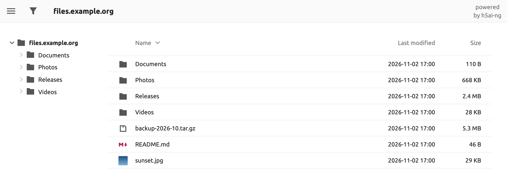
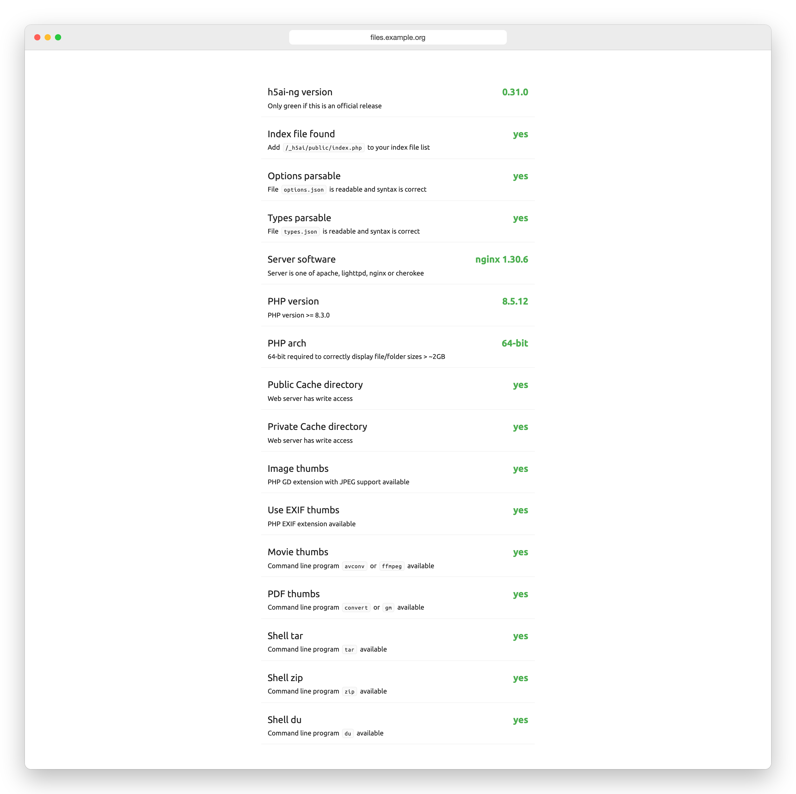

# h5ai-ng

[English](README.md) · [한국어](README.ko.md) · **Español** · [日本語](README.ja.md) · [简体中文](README.zh-CN.md)

[![license][license-img]][license] [![ci][ci-img]][ci] [![docker][docker-img]][docker-hub]

Un índice de archivos para Apache httpd, lighttpd y nginx. Los visitantes
recorren carpetas, previsualizan imágenes, vídeo, audio y texto, filtran por
nombre y descargan una selección completa como un solo archivo comprimido. Sus
archivos se quedan donde están.

h5ai-ng es un fork mantenido de [h5ai][h5ai], de Lars Jung, que dejó de
publicar versiones en 2021.

## Por qué h5ai-ng

* **Solo lectura, sin base de datos.** Sustituye el listado de directorios
  del servidor y nunca escribe en sus archivos.
* **PHP actual.** Funciona con PHP 8.3 o posterior; la imagen de Docker
  incluye PHP 8.5.
* **Sin peticiones a terceros.** Las fuentes vienen con la interfaz, así que
  cargar la página no sale de su servidor.
* **Su configuración de h5ai sigue valiendo.** `options.json`, las URL y los
  temas de iconos `default` y `comity` siguen funcionando.

## Inicio rápido con Docker

~~~sh
docker run -d --name h5ai -p 80:80 \
  -v /path/to/files:/h5ai \
  -v /path/to/config:/config \
  -e PUID=1000 -e PGID=1000 -e TZ=Europe/Madrid \
  --restart unless-stopped \
  awesometic/h5ai-ng
~~~

Abra `http://localhost/`. Se publican imágenes para `linux/amd64`,
`linux/arm64`, `linux/arm/v7` y `linux/arm/v6`.

La imagen incluye lo que necesitan las funciones opcionales: miniaturas de
imágenes, vídeo y PDF, descargas tar y zip y tamaños de carpeta. Al iniciar
sesión en su página de información (`/_h5ai/public/index.php`), todas las
comprobaciones aparecen superadas:

| Volumen | Contenido |
| --- | --- |
| `/h5ai` | Los archivos que se sirven. Puede montarlo en solo lectura (`:ro`). |
| `/config` | `h5ai/_h5ai` (la aplicación y su `options.json`) y `nginx/h5ai.conf`. Se crea en el primer arranque; una imagen más nueva sustituye la aplicación y conserva `options.json`. |
| `/logs` | Opcional. Registros de Nginx y PHP que sobreviven al contenedor. |

| Variable | Valor por defecto | Significado |
| --- | --- | --- |
| `PUID`, `PGID` | `911` | Propietario de `/config` y de los procesos de trabajo de nginx y PHP. |
| `TZ` | `Asia/Seoul` | Zona horaria del reloj del contenedor, los registros y su rotación. El listado muestra las fechas en la zona horaria del navegador del visitante. |
| `HTPASSWD` | `false` | Con `true`, se pide usuario y contraseña a cada visitante. |
| `HTPASSWD_USER`, `HTPASSWD_PW` | `guest`, vacío | Los datos de acceso. Sin contraseña, arranque una vez con `-it` para escribirla. |
| `LOG_ROTATE_INTERVAL_DAYS`, `LOG_RETENTION_DAYS` | `1`, `30` | Rotación de los archivos en `/logs`, en días. |

La imagen sirve HTTP sin cifrar. Ponga delante un proxy inverso con TLS,
sobre todo si usa `HTPASSWD`.

## Instalación en su propio servidor

1. Descargue `h5ai-<version>.zip` desde [Releases][releases] o compílelo (ver
   más abajo). **No** copie archivos de `src`; primero hay que compilarlos.
2. Descomprímalo en la raíz web, de modo que `_h5ai` quede junto a sus archivos.
3. Añada `/_h5ai/public/index.php` como último índice de directorio:
   * Apache httpd: `DirectoryIndex index.html index.php /_h5ai/public/index.php`
   * lighttpd: `index-file.names += ("/_h5ai/public/index.php")`
   * nginx: `index index.html index.php /_h5ai/public/index.php;`
4. Bloquee `/_h5ai/private/`, que contiene `options.json` y el hash de la
   contraseña. Los archivos `.htaccess` de `_h5ai` solo lo hacen en Apache httpd
   con `AllowOverride All`; el Apache empaquetado de Debian, por ejemplo, trae
   `AllowOverride None`. Si su raíz web no tiene `AllowOverride All`, añada la
   regla de su servidor:

   ~~~apache
   <Location "/_h5ai/private/">
       Require all denied
   </Location>
   ~~~

   ~~~lighttpd
   $HTTP["url"] =~ "^/_h5ai/private/" { url.access-deny = ("") }
   ~~~

   ~~~nginx
   location ^~ /_h5ai/private/ { deny all; }
   ~~~

   La regla de lighttpd necesita `mod_access`. Después compruebe que
   `curl -I http://su-servidor/_h5ai/private/conf/options.json` responde 403.
5. Permita que el usuario del servidor web escriba en `_h5ai/public/cache` y
   `_h5ai/private/cache`. La página de información muestra si puede.

Se necesita PHP 8.3 o posterior. Los visitantes necesitan Chrome o Edge 91,
Firefox 90 o Safari 15; los navegadores más antiguos reciben una lista simple.

## Configuración

Los ajustes están en `_h5ai/private/conf/options.json` (en Docker:
`/config/h5ai/_h5ai/private/conf/options.json`). Cada opción se describe en
el propio archivo.

`/_h5ai/public/index.php` abre la página de información, que comprueba qué
admite su servidor. Su contraseña predefinida está vacía, así que defina la
suya: ponga su hash SHA-512 en `passhash`.

~~~sh
printf '%s' 'su contraseña' | sha512sum    # macOS: shasum -a 512
~~~

## Migrar desde docker-h5ai

Quien use [docker-h5ai][docker-h5ai] conserva sus volúmenes y variables y
solo cambia el nombre de la imagen.

1. Haga una copia de seguridad de la carpeta de configuración:
   `cp -a /path/to/config /path/to/config.bak`
2. Elimine el contenedor antiguo y arranque `awesometic/h5ai-ng` con las
   mismas opciones `-v` y `-e`:
   `docker rm -f h5ai` y después el comando `docker run` de arriba.
3. Lea `docker logs h5ai`. En el primer arranque, el contenedor:
   * sustituye `/config/h5ai/_h5ai` por la nueva versión pero conserva su
     `options.json` y guarda una copia como `/config/<date>_options.json.bak`;
   * bloquea `/_h5ai/private/` en `/config/nginx/h5ai.conf` y guarda el
     archivo anterior como `/config/<date>_h5ai.conf.bak`. Si ese archivo se
     modificó demasiado para actualizarlo, el contenedor se detiene e indica
     qué cambiar.

Su `options.json` queda como estaba, contraseña incluida. Salvo que cambiara
esas entradas, mantiene el filtro desactivado y carga las fuentes desde Google
Fonts; compárelo con los [nuevos valores por defecto][options] si quiere esos
cambios. Los demás archivos que modificara en `_h5ai`, como `types.json`, un
tema o una traducción, se sustituyen por la nueva versión; cópielos de nuevo
desde la copia del paso 1.

Para volver atrás, detenga el contenedor, restaure `/path/to/config.bak` y
arranque de nuevo `awesometic/h5ai`.

## Compilación

Requiere [Node.js 24][node]. La carpeta `_h5ai` compilada queda en `build`.

~~~sh
npm ci
npm run build     # build/_h5ai
npm run release   # también build/h5ai-<version>.zip (requiere zip)
docker build -t h5ai-ng .
~~~

Los errores y las pull requests van a [este repositorio][issues]. Las pull
requests abiertas del h5ai original se revisan aquí una a una.

## Otro proyecto del mantenedor

[ToneDial][tonedial] da carácter a su agente de programación. Elija uno de los
7 personajes o ajuste 12 ejes de tono, y esta CLI local aplica esa voz a
Claude Code, Codex o Antigravity en todos sus proyectos. Aún está en
desarrollo y requiere Node 22 o posterior.

~~~sh
npm install --global tonedial
~~~

## Licencia

Licencia MIT. Se reproduce el texto original en inglés.

The MIT License (MIT)

Copyright (c) 2020 Lars Jung (https://larsjung.de)

Permission is hereby granted, free of charge, to any person obtaining a copy
of this software and associated documentation files (the "Software"), to deal
in the Software without restriction, including without limitation the rights
to use, copy, modify, merge, publish, distribute, sublicense, and/or sell
copies of the Software, and to permit persons to whom the Software is
furnished to do so, subject to the following conditions:

The above copyright notice and this permission notice shall be included in
all copies or substantial portions of the Software.

THE SOFTWARE IS PROVIDED "AS IS", WITHOUT WARRANTY OF ANY KIND, EXPRESS OR
IMPLIED, INCLUDING BUT NOT LIMITED TO THE WARRANTIES OF MERCHANTABILITY,
FITNESS FOR A PARTICULAR PURPOSE AND NONINFRINGEMENT. IN NO EVENT SHALL THE
AUTHORS OR COPYRIGHT HOLDERS BE LIABLE FOR ANY CLAIM, DAMAGES OR OTHER
LIABILITY, WHETHER IN AN ACTION OF CONTRACT, TORT OR OTHERWISE, ARISING FROM,
OUT OF OR IN CONNECTION WITH THE SOFTWARE OR THE USE OR OTHER DEALINGS IN
THE SOFTWARE.

## Referencias

**h5ai** se apoya en otros proyectos, todos ellos también con licencia MIT.
Las excepciones son algunos [iconos de Material Design][material-design-icons]
(CC BY 4.0) y las fuentes Ubuntu y Ubuntu Mono ([`@fontsource/ubuntu`][fontsource-ubuntu]
y [`@fontsource/ubuntu-mono`][fontsource-ubuntu-mono] 5.3.0, Ubuntu Font Licence 1.0),
que se incluyen sin modificar en `_h5ai/public/fonts/` junto con la licencia.

[h5ai]: https://larsjung.de/h5ai/
[tonedial]: https://github.com/awesometic/tonedial
[license]: #licencia
[ci]: https://github.com/awesometic/h5ai-ng/actions/workflows/ci.yml
[docker-hub]: https://hub.docker.com/r/awesometic/h5ai-ng
[releases]: https://github.com/awesometic/h5ai-ng/releases
[issues]: https://github.com/awesometic/h5ai-ng/issues
[docker-h5ai]: https://github.com/awesometic/docker-h5ai
[options]: https://github.com/awesometic/h5ai-ng/blob/main/src/_h5ai/private/conf/options.json
[node]: https://nodejs.org
[material-design-icons]: https://github.com/google/material-design-icons
[fontsource-ubuntu]: https://www.npmjs.com/package/@fontsource/ubuntu
[fontsource-ubuntu-mono]: https://www.npmjs.com/package/@fontsource/ubuntu-mono

[license-img]: https://img.shields.io/badge/license-MIT-a0a060.svg?style=flat-square
[ci-img]: https://img.shields.io/github/actions/workflow/status/awesometic/h5ai-ng/ci.yml?branch=main&style=flat-square
[docker-img]: https://img.shields.io/docker/pulls/awesometic/h5ai-ng?style=flat-square
