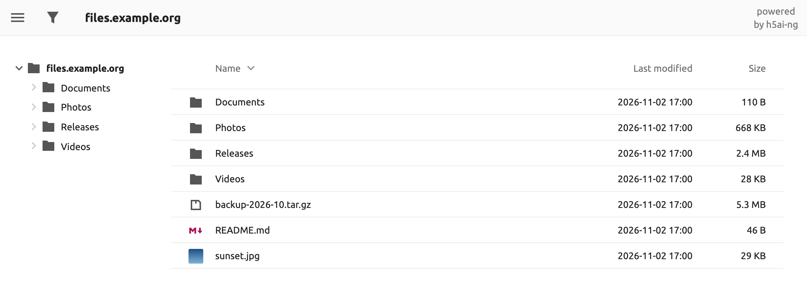
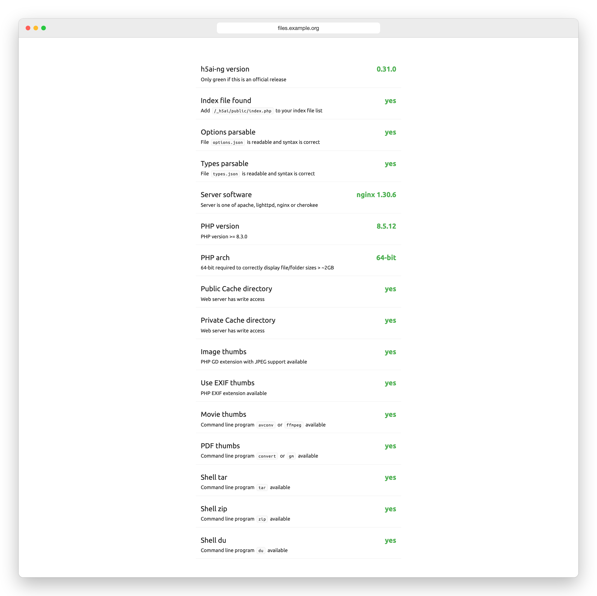

# h5ai-ng

[English](README.md) · [한국어](README.ko.md) · [Español](README.es.md) · **日本語** · [简体中文](README.zh-CN.md)

[![multiarch][arch-img]][docker-hub]
[![build][ci-img]][ci]

[![image size][size-img]][docker-hub]
[![docker pulls][pulls-img]][docker-hub]
[![docker stars][stars-img]][docker-hub]

Apache httpd、lighttpd、nginx 向けのファイル一覧ページです。訪問者はフォルダーを
たどり、画像・動画・音声・テキストをプレビューし、名前で絞り込み、選んだファイルを
まとめて 1 つのアーカイブとしてダウンロードできます。ファイルは今ある場所のままです。

h5ai-ng は、2021 年を最後にリリースが止まった Lars Jung 氏の [h5ai][h5ai] を
引き継いで保守するフォークです。

公式サイトでは次のように紹介されています。

> h5ai is a modern file indexer for HTTP web servers with focus on your files. Directories are displayed in a appealing way and browsing them is enhanced by different views, a breadcrumb and a tree overview. Initially h5ai was an acronym for HTML5 Apache Index but now it supports other web servers too.

## h5ai-ng の特長

* **読み取り専用で、データベースは不要です。** サーバー標準のディレクトリ一覧を
  置き換えるだけで、ファイルには一切書き込みません。
* **最新の PHP で動きます。** PHP 8.3 以降に対応し、Docker イメージには PHP 8.5 が
  入っています。
* **外部サーバーへのリクエストはありません。** フォントを同梱しているので、
  ページの読み込みは自分のサーバー内で完結します。
* **h5ai の設定をそのまま使えます。** `options.json`、URL、`default` と `comity`
  のアイコンテーマはそのまま動きます。

## Docker ですぐに使う

~~~sh
docker run -d --name h5ai -p 80:80 \
  -v /path/to/files:/h5ai \
  -v /path/to/config:/config \
  -e PUID=1000 -e PGID=1000 -e TZ=Asia/Tokyo \
  --restart unless-stopped \
  awesometic/h5ai-ng
~~~

`http://localhost/` を開いてください。イメージは `linux/amd64`、`linux/arm64`、
`linux/arm/v7`、`linux/arm/v6` 向けに公開しています。

イメージには、画像・動画・PDF のサムネイル、tar と zip のダウンロード、フォルダーサイズの
表示に必要なものがすべて入っています。情報ページ（`/_h5ai/public/index.php`）に
ログインすると、すべてのチェックが合格になっています。

| ボリューム | 内容 |
| --- | --- |
| `/h5ai` | 公開するファイル。必要なら読み取り専用（`:ro`）でマウントしてください。 |
| `/config` | `h5ai/_h5ai`（アプリケーションと `options.json`）と `nginx/h5ai.conf`。初回起動時に作られ、新しいイメージはアプリケーションだけを置き換えて `options.json` はそのまま残します。 |
| `/logs` | 任意。コンテナーを削除しても残る Nginx と PHP のログ。 |

| 変数 | 既定値 | 意味 |
| --- | --- | --- |
| `PUID`, `PGID` | `911` | `/config` と nginx・PHP のワーカープロセスの所有者。 |
| `TZ` | `Asia/Seoul` | コンテナーの時計、ログ、ログローテーションのタイムゾーン。一覧の日付は訪問者のブラウザーのタイムゾーンで表示されます。 |
| `HTPASSWD` | `false` | `true` にすると、すべての訪問者にログインを求めます。 |
| `HTPASSWD_USER`, `HTPASSWD_PW` | `guest`、空 | ログイン情報。パスワードが空なら、一度 `-it` 付きで起動して入力してください。 |
| `LOG_ROTATE_INTERVAL_DAYS`, `LOG_RETENTION_DAYS` | `1`、`30` | `/logs` 以下のファイルのローテーション間隔と保存期間（日）。 |
| `LOG_READ_GID` | `PGID` の値 | `/logs` 以下のファイルを読めるホストのグループ ID（数値）。 |

`docker logs h5ai` で nginx のリクエストとエラー、PHP のエラーを確認できます。
`/logs` をマウントすると、同じ記録がその中の `nginx/access.log`、
`nginx/error.log`、`php/error.log` にも書き込まれます。ファイルは `TZ` の
午前 0 時を過ぎると `LOG_ROTATE_INTERVAL_DAYS` 日ごとにローテーションされ、
次のローテーションで圧縮され、ローテーションから `LOG_RETENTION_DAYS` 日後に
削除されます。どちらの値も 1 から 36500 までで、保存期間はローテーション間隔より
短くできません。ファイルの所有者は root で、`LOG_READ_GID` のグループは読み取り
だけができます。`/logs` は書き込み可能でマウントし、コンテナーごとに別の
フォルダーを使ってください。`/logs/.state` にローテーションの予定が保存されるので、
残しておけばコンテナーを作り直しても予定が引き継がれます。

イメージは暗号化されていない HTTP で応答します。前段に TLS 対応のリバースプロキシを
置いてください。`HTPASSWD` を使う場合は特に必要です。

別のホストポートを使うには、`-p` の最初の数字を変えます（例: `-p 8080:80`）。
`/h5ai` 内を指すハードリンクとシンボリックリンクはそのまま動作します。`/h5ai` の
外を指すシンボリックリンクは、リンク先をコンテナー内の同じパスにマウントする
必要があります（例: `-v /mnt/media:/mnt/media:ro`）。

h5ai を `/share/` のようなパスの下で提供するには、リバースプロキシでそのパスを
取り除き、`X-Forwarded-Prefix` で伝えます。

~~~nginx
location /share/ {
    proxy_pass http://127.0.0.1:8080/;
    proxy_set_header Host $host;
    proxy_set_header X-Forwarded-Prefix /share;
    proxy_redirect / /share/;
}
~~~

0.31.1 より前に保存された `/config/nginx/h5ai.conf` はこのヘッダーを読みません。
現在の既定の設定にする方法は [docker-h5ai からの移行](#docker-h5ai-からの移行) を
参照してください。

## 自分のサーバーにインストールする

1. [Releases][releases] から `h5ai-<version>.zip` をダウンロードするか、ビルドします
   （後述）。`src` のファイルをそのままコピーしては**いけません**。先にビルドが必要です。
2. Web ルートに展開し、`_h5ai` が公開するファイルと同じ階層に来るようにします。
3. ディレクトリインデックスの最後に `/_h5ai/public/index.php` を追加します。
   * Apache httpd: `DirectoryIndex index.html index.php /_h5ai/public/index.php`
   * lighttpd: `index-file.names += ("/_h5ai/public/index.php")`
   * nginx: `index index.html index.php /_h5ai/public/index.php;`
4. `options.json` とパスワードハッシュを含む `/_h5ai/private/` へのアクセスを
   禁止してください。`_h5ai` 内の `.htaccess` ファイルが効くのは
   `AllowOverride All` の Apache httpd だけで、Debian パッケージの Apache などは
   `AllowOverride None` が初期値です。Web ルートが `AllowOverride All` でなければ、
   サーバーに合わせたルールを追加します。

   ~~~apache
   <Location "/_h5ai/private/">
       Require all denied
   </Location>
   ~~~

   ~~~lighttpd
   $HTTP["url"] =~ "^/_h5ai/private/" { url.access-deny = ("") }
   ~~~

   ~~~nginx
   location ^~ /_h5ai/private/ { deny all; }
   ~~~

   lighttpd のルールには `mod_access` が必要です。設定後、
   `curl -I http://your-server/_h5ai/private/conf/options.json` が 403 を返すことを確認してください。
5. Web サーバーのユーザーが `_h5ai/public/cache` と `_h5ai/private/cache` に
   書き込めるようにします。書き込めるかどうかは情報ページで確認できます。

PHP 8.3 以降が必要です。訪問者のブラウザーは Chrome または Edge 91、Firefox 90、
Safari 15 以降が必要で、それより古いブラウザーには簡易な一覧が表示されます。

## 設定

設定は `_h5ai/private/conf/options.json` にあります（Docker では
`/config/h5ai/_h5ai/private/conf/options.json`）。各オプションの説明はファイル内に
書かれています。

`/_h5ai/public/index.php` を開くと、サーバーが何に対応しているかを確認できる
情報ページが表示されます。このページの初期パスワードは空なので、自分で設定して
ください。パスワードの SHA-512 ハッシュを `passhash` に入れます。

~~~sh
printf '%s' 'パスワード' | sha512sum    # macOS: shasum -a 512
~~~

## docker-h5ai からの移行

[docker-h5ai][docker-h5ai] を使っている場合、ボリュームと変数はそのままで、
イメージ名だけを変えます。

1. 設定フォルダーをバックアップします。
   `cp -a /path/to/config /path/to/config.bak`
2. 古いコンテナーを削除し、同じ `-v` と `-e` オプションで `awesometic/h5ai-ng` を
   起動します。`docker rm -f h5ai` を実行してから、上の `docker run` コマンドを使います。
   Compose の場合は `image:` を変更して `docker compose up -d` を実行します。
3. `docker logs h5ai` を確認します。初回起動時、コンテナーは次のことを行います。
   * `/config/h5ai/_h5ai` を新しいバージョンに置き換えますが、`options.json` は
     そのまま残し、そのコピーを `/config/<date>_options.json.bak` として保存します。
   * `/config/nginx/h5ai.conf` で `/_h5ai/private/` をブロックし、以前のファイルを
     `/config/<date>_h5ai.conf.bak` として保存します。ファイルの変更が大きすぎて
     更新できない場合、コンテナーは停止し、直すべき箇所を表示します。

`options.json` はパスワードも含めて以前のままです。該当する項目を変えていなければ、
フィルターはオフのままで、フォントを Google Fonts から読み込みます。新しい既定値を
取り入れたい場合は、[新しい既定の設定][options]と比べてください。`types.json`、
テーマ、翻訳など `_h5ai` 内で変更したほかのファイルは新しいバージョンに置き換わる
ので、手順 1 のバックアップからコピーし直してください。

初回起動で保存済みの `h5ai.conf` に追加されるのは、このブロックだけです。
フォルダーのリダイレクトでマッピングしたポートを保ち、
`X-Forwarded-Prefix` を読む現在の既定の設定にするには、コンテナーを削除してから
ファイルを削除し、上の `docker run` コマンドをもう一度実行します。

~~~sh
docker rm -f h5ai
rm /path/to/config/nginx/h5ai.conf
~~~

このファイルを変更していた場合は、新しいファイルに変更を入れ直してください。

元に戻すには、コンテナーを削除し、バックアップを元の場所に戻してから、
`awesometic/h5ai` をもう一度起動します。

~~~sh
docker rm -f h5ai
mv /path/to/config /path/to/config.ng
cp -a /path/to/config.bak /path/to/config
~~~

## ビルド

[Node.js 24][node] が必要です。ビルドした `_h5ai` フォルダーは `build` にできます。

~~~sh
npm ci
npm run build     # build/_h5ai
npm run release   # build/h5ai-<version>.zip も作成（zip が必要）
docker build -t h5ai-ng .
~~~

バグ報告とプルリクエストは[このリポジトリ][issues]へお願いします。元の h5ai で
開いたままのプルリクエストも、ここで 1 件ずつ検討しています。

## メンテナーのもう 1 つのプロジェクト

[ToneDial][tonedial] は、コーディングエージェントにキャラクターを与えるローカル CLI です。
7 種類のキャラクターから選ぶか 12 のトーン軸を調整すると、Claude Code、Codex、
Antigravity がどのプロジェクトでもその口調で応答します。現在開発中で、Node 22 以降が
必要です。

~~~sh
npm install --global tonedial
~~~

## ライセンス

MIT ライセンスで配布しています。h5ai と h5ai-ng の著作権表示を含む全文は
[LICENSE](LICENSE) にあります。

## 利用しているプロジェクト

**h5ai** はほかのプロジェクトの成果を利用しており、それらもすべて MIT ライセンスです。
例外は一部の [Material Design アイコン][material-design-icons]（CC BY 4.0）と、
Ubuntu および Ubuntu Mono フォント（[`@fontsource/ubuntu`][fontsource-ubuntu] と
[`@fontsource/ubuntu-mono`][fontsource-ubuntu-mono] 5.3.0、Ubuntu Font Licence 1.0）です。
フォントは改変せず、ライセンスとともに `_h5ai/public/fonts/` に同梱しています。

[h5ai]: https://larsjung.de/h5ai/
[tonedial]: https://github.com/awesometic/tonedial
[ci]: https://github.com/awesometic/h5ai-ng/actions/workflows/ci.yml
[docker-hub]: https://hub.docker.com/r/awesometic/h5ai-ng
[releases]: https://github.com/awesometic/h5ai-ng/releases
[issues]: https://github.com/awesometic/h5ai-ng/issues
[docker-h5ai]: https://github.com/awesometic/docker-h5ai
[options]: https://github.com/awesometic/h5ai-ng/blob/main/src/_h5ai/private/conf/options.json
[node]: https://nodejs.org
[material-design-icons]: https://github.com/google/material-design-icons
[fontsource-ubuntu]: https://www.npmjs.com/package/@fontsource/ubuntu
[fontsource-ubuntu-mono]: https://www.npmjs.com/package/@fontsource/ubuntu-mono

[arch-img]: https://img.shields.io/badge/multiarch-amd64(x86__64)%2C%20arm64%2C%20armv7%2C%20armv6-lightgrey?style=flat-square
[ci-img]: https://img.shields.io/github/actions/workflow/status/awesometic/h5ai-ng/ci.yml?branch=main&style=flat-square
[size-img]: https://img.shields.io/docker/image-size/awesometic/h5ai-ng/latest?style=flat-square
[pulls-img]: https://img.shields.io/docker/pulls/awesometic/h5ai-ng?style=flat-square
[stars-img]: https://img.shields.io/docker/stars/awesometic/h5ai-ng?style=flat-square
