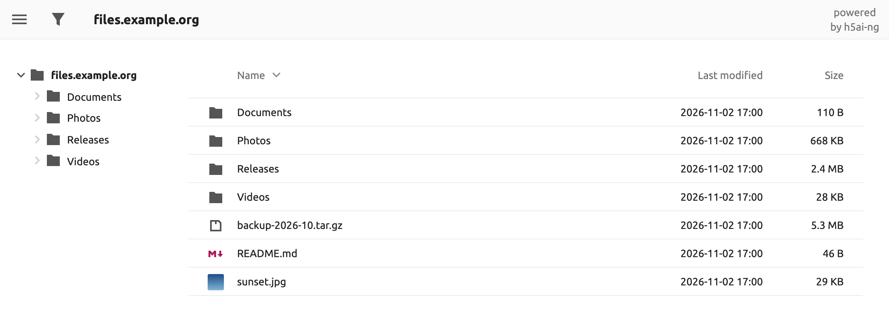

# h5ai-ng

[English](README.md) · **한국어** · [Español](README.es.md) · [日本語](README.ja.md) · [简体中文](README.zh-CN.md)

[![license][license-img]][license] [![ci][ci-img]][ci] [![docker][docker-img]][docker-hub]

Apache httpd, lighttpd, nginx에서 쓰는 파일 목록 페이지입니다. 방문자는 폴더를
둘러보고, 이미지·동영상·오디오·텍스트를 미리 보고, 이름으로 걸러 내고, 고른
파일을 압축 파일 하나로 내려받습니다. 파일은 원래 자리에 그대로 있습니다.

h5ai-ng는 Lars Jung이 만든 [h5ai][h5ai]의 포크입니다. 원본은 2021년 이후 새
버전이 나오지 않아 이곳에서 이어서 관리합니다.

## h5ai-ng를 쓰는 이유

* **읽기 전용이고 데이터베이스가 없습니다.** 서버의 기본 디렉터리 목록을 대신할
  뿐, 파일에는 아무것도 쓰지 않습니다.
* **최신 PHP에서 동작합니다.** PHP 8.3 이상을 지원하고 Docker 이미지에는
  PHP 8.5가 들어 있습니다.
* **외부 서버에 요청하지 않습니다.** 글꼴을 함께 배포하므로 페이지를 열어도 내
  서버 밖으로 나가는 요청이 없습니다.
* **쓰던 h5ai 설정을 그대로 씁니다.** `options.json`, URL, `default`와 `comity`
  아이콘 테마가 그대로 동작합니다.

## Docker로 바로 시작하기

~~~sh
docker run -d --name h5ai -p 80:80 \
  -v /path/to/files:/h5ai \
  -v /path/to/config:/config \
  -e PUID=1000 -e PGID=1000 -e TZ=Asia/Seoul \
  --restart unless-stopped \
  awesometic/h5ai-ng
~~~

`http://localhost/`를 열면 됩니다. 이미지는 `linux/amd64`, `linux/arm64`,
`linux/arm/v7`, `linux/arm/v6`용으로 배포합니다.

| 볼륨 | 내용 |
| --- | --- |
| `/h5ai` | 공유할 파일. 필요하면 읽기 전용(`:ro`)으로 마운트하세요. |
| `/config` | `h5ai/_h5ai`(애플리케이션과 `options.json`)와 `nginx/h5ai.conf`. 처음 시작할 때 만들어집니다. |
| `/logs` | 선택 사항. 컨테이너를 지워도 남는 Nginx와 PHP 로그. |

| 변수 | 기본값 | 설명 |
| --- | --- | --- |
| `PUID`, `PGID` | `911` | `/config`와 서버 프로세스의 소유자. |
| `TZ` | `Asia/Seoul` | 날짜 표시와 로그 교체에 쓰는 시간대. |
| `HTPASSWD` | `false` | `true`이면 모든 방문자에게 로그인을 요구합니다. |
| `HTPASSWD_USER`, `HTPASSWD_PW` | `guest`, 빈 값 | 로그인 계정. 비밀번호를 비워 두었다면 처음 한 번은 `-it`로 실행해 직접 입력하세요. |
| `LOG_ROTATE_INTERVAL_DAYS`, `LOG_RETENTION_DAYS` | `1`, `30` | `/logs` 아래 파일의 교체 주기와 보관 기간(일). |

이미지는 암호화하지 않은 HTTP로 응답합니다. 앞단에 TLS를 적용한 리버스
프록시를 두세요. `HTPASSWD`를 쓴다면 더욱 그렇습니다.

## 직접 운영하는 서버에 설치하기

1. [Releases][releases]에서 `h5ai-<version>.zip`을 받거나 직접 빌드합니다(아래
   참고). `src`의 파일을 그대로 복사하면 **안 됩니다**. 먼저 빌드해야 합니다.
2. 웹 루트에 압축을 풀어 `_h5ai` 폴더가 공유할 파일들과 같은 위치에 오게 합니다.
3. 디렉터리 인덱스의 마지막 항목으로 `/_h5ai/public/index.php`를 추가합니다.
   * Apache httpd: `DirectoryIndex index.html index.php /_h5ai/public/index.php`
   * lighttpd: `index-file.names += ("/_h5ai/public/index.php")`
   * nginx: `index index.html index.php /_h5ai/public/index.php;`
4. nginx라면 `/_h5ai/private/` 접근을 막으세요. 이 경로를 지키는 `.htaccess`
   파일은 Apache httpd에서만 동작합니다.

   ~~~nginx
   location ^~ /_h5ai/private/ { deny all; }
   ~~~

서버에는 PHP 8.3 이상이 필요합니다. 방문자는 Chrome·Edge 91, Firefox 90,
Safari 15 이상을 써야 하고 그보다 오래된 브라우저에서는 단순한 목록이 나옵니다.

## 설정

설정 파일은 `_h5ai/private/conf/options.json`입니다(Docker에서는
`/config/h5ai/_h5ai/private/conf/options.json`). 옵션마다 파일 안에 설명이
있습니다.

`/_h5ai/public/index.php`를 열면 서버가 어떤 기능을 지원하는지 점검하는 정보
페이지가 나옵니다. 이 페이지의 기본 비밀번호는 비어 있으니 직접 정하세요.
비밀번호의 SHA-512 해시를 `passhash`에 넣으면 됩니다.

~~~sh
printf '%s' '비밀번호' | sha512sum    # macOS: shasum -a 512
~~~

## docker-h5ai에서 옮겨 오기

[docker-h5ai][docker-h5ai]를 쓰고 있다면 볼륨과 변수는 그대로 두고 이미지
이름만 바꾸면 됩니다.

1. 설정 폴더를 백업합니다.
   `cp -a /path/to/config /path/to/config.bak`
2. 기존 컨테이너를 지우고 같은 `-v`와 `-e` 옵션으로 `awesometic/h5ai-ng`를
   실행합니다. `docker rm -f h5ai`를 실행한 뒤 위의 `docker run` 명령을 씁니다.
3. `docker logs h5ai`로 로그를 확인합니다. 처음 시작할 때 컨테이너가 하는 일은
   다음과 같습니다.
   * `/config/h5ai/_h5ai`를 새 버전으로 바꾸고 기존 설정은
     `/config/<date>_options.json.bak`에 저장합니다.
   * `/config/nginx/h5ai.conf`에 `/_h5ai/private/` 차단 규칙을 넣고 기존 파일은
     `/config/<date>_h5ai.conf.bak`에 저장합니다. 이 파일을 많이 고쳐서 자동으로
     바꿀 수 없으면 컨테이너가 멈추고 고칠 곳을 알려 줍니다.
4. 설정을 되살립니다. 새 `options.json`은 기본값으로 시작하므로 정보 페이지
   비밀번호도 비어 있습니다. 예전 설정을 그대로 쓰려면 백업 파일로 덮어쓰고
   다시 시작하세요.

   ~~~sh
   cp /path/to/config/<date>_options.json.bak \
      /path/to/config/h5ai/_h5ai/private/conf/options.json
   docker restart h5ai
   ~~~

   예전 파일은 따로 바꾸지 않았다면 필터가 꺼져 있고 글꼴을 Google Fonts에서
   불러옵니다. 새 기본값을 쓰고 싶다면 두 파일을 비교해 필요한 부분만 옮기세요.

되돌리려면 컨테이너를 멈추고 `/path/to/config.bak`을 복원한 뒤
`awesometic/h5ai`를 다시 실행합니다.

## 빌드

[Node.js 24][node]가 필요합니다. 빌드한 `_h5ai` 폴더는 `build`에 생깁니다.

~~~sh
npm ci
npm run build     # build/_h5ai
npm run release   # build/h5ai-<version>.zip도 만듭니다(zip 필요)
docker build -t h5ai-ng .
~~~

버그 제보와 풀 리퀘스트는 [이 저장소][issues]로 보내 주세요. 원본 h5ai에 열려
있던 풀 리퀘스트도 이곳에서 하나씩 검토합니다.

## 메인테이너의 다른 프로젝트

[ToneDial][tonedial]은 코딩 에이전트에게 캐릭터를 입히는 로컬 CLI입니다. 캐릭터
7종 중 하나를 고르거나 톤 축 12개를 조절하면 Claude Code·Codex·Antigravity가 여러
프로젝트에서 그 말투로 답합니다. 아직 개발 중이며 Node 22 이상이 필요합니다.

~~~sh
npm install --global tonedial
~~~

## 라이선스

MIT 라이선스입니다. 원문을 그대로 싣습니다.

The MIT License (MIT)

Copyright (c) 2020 Lars Jung (https://larsjung.de)

Permission is hereby granted, free of charge, to any person obtaining a copy
of this software and associated documentation files (the "Software"), to deal
in the Software without restriction, including without limitation the rights
to use, copy, modify, merge, publish, distribute, sublicense, and/or sell
copies of the Software, and to permit persons to whom the Software is
furnished to do so, subject to the following conditions:

The above copyright notice and this permission notice shall be included in
all copies or substantial portions of the Software.

THE SOFTWARE IS PROVIDED "AS IS", WITHOUT WARRANTY OF ANY KIND, EXPRESS OR
IMPLIED, INCLUDING BUT NOT LIMITED TO THE WARRANTIES OF MERCHANTABILITY,
FITNESS FOR A PARTICULAR PURPOSE AND NONINFRINGEMENT. IN NO EVENT SHALL THE
AUTHORS OR COPYRIGHT HOLDERS BE LIABLE FOR ANY CLAIM, DAMAGES OR OTHER
LIABILITY, WHETHER IN AN ACTION OF CONTRACT, TORT OR OTHERWISE, ARISING FROM,
OUT OF OR IN CONNECTION WITH THE SOFTWARE OR THE USE OR OTHER DEALINGS IN
THE SOFTWARE.

## 사용한 프로젝트

**h5ai**는 다른 여러 프로젝트의 도움을 받았고, 그 프로젝트들도 모두 MIT 라이선스입니다. 예외는 일부
[Material Design 아이콘][material-design-icons](CC BY 4.0)과 Ubuntu, Ubuntu Mono
글꼴([`@fontsource/ubuntu`][fontsource-ubuntu], [`@fontsource/ubuntu-mono`][fontsource-ubuntu-mono]
5.3.0, Ubuntu Font Licence 1.0)입니다. 글꼴은 수정하지 않은 채 라이선스와 함께
`_h5ai/public/fonts/`에 들어 있습니다.

[h5ai]: https://larsjung.de/h5ai/
[tonedial]: https://github.com/awesometic/tonedial
[license]: #라이선스
[ci]: https://github.com/awesometic/h5ai-ng/actions/workflows/ci.yml
[docker-hub]: https://hub.docker.com/r/awesometic/h5ai-ng
[releases]: https://github.com/awesometic/h5ai-ng/releases
[issues]: https://github.com/awesometic/h5ai-ng/issues
[docker-h5ai]: https://github.com/awesometic/docker-h5ai
[node]: https://nodejs.org
[material-design-icons]: https://github.com/google/material-design-icons
[fontsource-ubuntu]: https://www.npmjs.com/package/@fontsource/ubuntu
[fontsource-ubuntu-mono]: https://www.npmjs.com/package/@fontsource/ubuntu-mono

[license-img]: https://img.shields.io/badge/license-MIT-a0a060.svg?style=flat-square
[ci-img]: https://img.shields.io/github/actions/workflow/status/awesometic/h5ai-ng/ci.yml?branch=main&style=flat-square
[docker-img]: https://img.shields.io/docker/pulls/awesometic/h5ai-ng?style=flat-square
