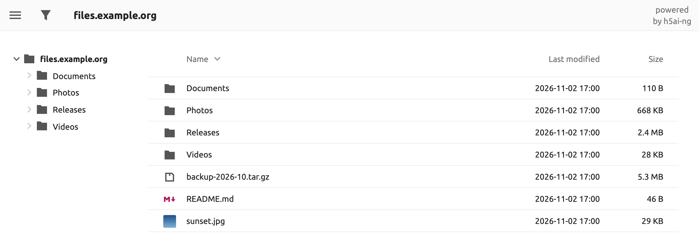
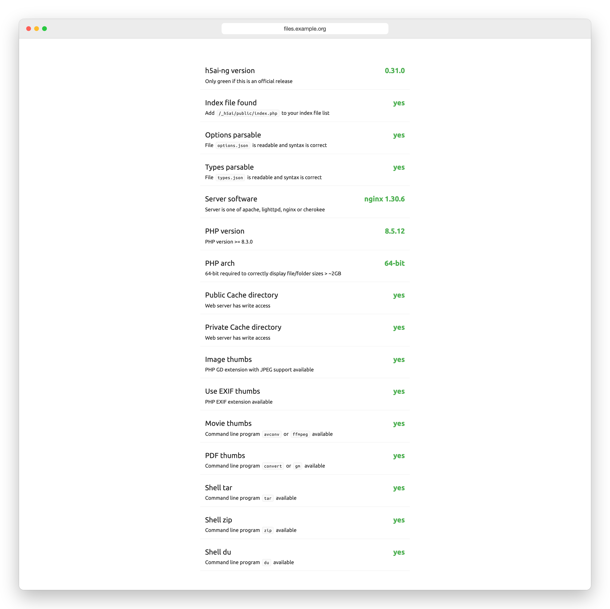

# h5ai-ng

**English** · [한국어](README.ko.md) · [Español](README.es.md) · [日本語](README.ja.md) · [简体中文](README.zh-CN.md)

[![license][license-img]][license] [![ci][ci-img]][ci] [![docker][docker-img]][docker-hub]

A file index for Apache httpd, lighttpd and nginx. Visitors browse folders,
preview images, video, audio and text, filter by name and download a whole
selection as one archive. Your files stay where they are.

h5ai-ng is a maintained fork of [h5ai][h5ai] by Lars Jung, which stopped
releasing in 2021.

## Why h5ai-ng

* **Read-only, no database.** It replaces the server's plain directory listing
  and never writes to your files.
* **Current PHP.** Runs on PHP 8.3 and later; the Docker image ships PHP 8.5.
* **No third-party requests.** The fonts ship with the interface, so a page
  load stays on your server.
* **Your h5ai setup carries over.** `options.json`, URLs and the `default` and
  `comity` icon themes keep working.

## Quick start with Docker

~~~sh
docker run -d --name h5ai -p 80:80 \
  -v /path/to/files:/h5ai \
  -v /path/to/config:/config \
  -e PUID=1000 -e PGID=1000 -e TZ=Europe/Berlin \
  --restart unless-stopped \
  awesometic/h5ai-ng
~~~

Open `http://localhost/`. Images are published for `linux/amd64`,
`linux/arm64`, `linux/arm/v7` and `linux/arm/v6`.

The image ships what the optional features need: image, video and PDF
thumbnails, tar and zip downloads and folder sizes. Log in to its info page
(`/_h5ai/public/index.php`) and every check passes:

| Volume | Contents |
| --- | --- |
| `/h5ai` | The files to serve. Mount it read-only (`:ro`) if you like. |
| `/config` | `h5ai/_h5ai` (the application and its `options.json`) and `nginx/h5ai.conf`. Created on first start. |
| `/logs` | Optional. Nginx and PHP logs that survive the container. |

| Variable | Default | Meaning |
| --- | --- | --- |
| `PUID`, `PGID` | `911` | Owner of `/config` and the nginx and PHP workers. |
| `TZ` | `Asia/Seoul` | Time zone of the container's clock, the logs and their rotation. The listing shows dates in the visitor's browser time zone. |
| `HTPASSWD` | `false` | `true` asks every visitor for a login. |
| `HTPASSWD_USER`, `HTPASSWD_PW` | `guest`, empty | The login. Without a password, start once with `-it` to type it. |
| `LOG_ROTATE_INTERVAL_DAYS`, `LOG_RETENTION_DAYS` | `1`, `30` | Rotation of the files under `/logs`. |

The image serves plain HTTP. Put a reverse proxy with TLS in front of it,
especially with `HTPASSWD`.

## Install on your own server

1. Download `h5ai-<version>.zip` from [Releases][releases], or build it (see
   below). Do **not** copy files from `src`; they must be built first.
2. Unpack it into your web root, so that `_h5ai` sits next to your files.
3. Add `/_h5ai/public/index.php` as the last directory index:
   * Apache httpd: `DirectoryIndex index.html index.php /_h5ai/public/index.php`
   * lighttpd: `index-file.names += ("/_h5ai/public/index.php")`
   * nginx: `index index.html index.php /_h5ai/public/index.php;`
4. Block `/_h5ai/private/`, which holds `options.json` and its password hash.
   The `.htaccess` files in `_h5ai` do this only on Apache httpd with
   `AllowOverride All`; Debian's packaged Apache, for one, ships
   `AllowOverride None`. Unless your web root has `AllowOverride All`, add the
   rule for your server:

   ~~~apache
   <Location "/_h5ai/private/">
       Require all denied
   </Location>
   ~~~

   ~~~lighttpd
   $HTTP["url"] =~ "^/_h5ai/private/" { url.access-deny = ("") }
   ~~~

   ~~~nginx
   location ^~ /_h5ai/private/ { deny all; }
   ~~~

   The lighttpd rule needs `mod_access`. Then check that
   `curl -I http://your-server/_h5ai/private/conf/options.json` answers 403.
5. Let the web server user write to `_h5ai/public/cache` and
   `_h5ai/private/cache`. The info page shows whether it can.

PHP 8.3 or later is required. Visitors need Chrome or Edge 91, Firefox 90 or
Safari 15; older browsers get a plain list.

## Configuration

Settings live in `_h5ai/private/conf/options.json` (in Docker:
`/config/h5ai/_h5ai/private/conf/options.json`). Each option is described in
the file.

`/_h5ai/public/index.php` opens the info page, which checks what your server
supports. Its preset password is empty, so set your own: put the SHA-512 hash
of it in `passhash`.

~~~sh
printf '%s' 'your password' | sha512sum    # macOS: shasum -a 512
~~~

## Moving from docker-h5ai

[docker-h5ai][docker-h5ai] users keep their volumes and variables and change
only the image name.

1. Back up the config folder:
   `cp -a /path/to/config /path/to/config.bak`
2. Remove the old container and start `awesometic/h5ai-ng` with the same
   `-v` and `-e` options:
   `docker rm -f h5ai`, then the `docker run` command above.
3. Read `docker logs h5ai`. On the first start the container:
   * replaces `/config/h5ai/_h5ai` with the new version and saves your old
     settings as `/config/<date>_options.json.bak`;
   * blocks `/_h5ai/private/` in `/config/nginx/h5ai.conf` and saves the old
     file as `/config/<date>_h5ai.conf.bak`. If that file was changed too much
     to update, the container stops and prints what to change.
4. Bring your settings back. The new `options.json` starts from the defaults,
   including the empty info page password. To keep everything as it was, copy
   the backup over it and restart:

   ~~~sh
   cp /path/to/config/<date>_options.json.bak \
      /path/to/config/h5ai/_h5ai/private/conf/options.json
   docker restart h5ai
   ~~~

   Unless you changed those entries, the old file turns the filter off and
   loads fonts from Google Fonts; compare it with the new defaults if you want
   those changes.

To go back, stop the container, restore `/path/to/config.bak` and start
`awesometic/h5ai` again.

## Build

Requires [Node.js 24][node]. The built `_h5ai` folder lands in `build`.

~~~sh
npm ci
npm run build     # build/_h5ai
npm run release   # also build/h5ai-<version>.zip (needs zip)
docker build -t h5ai-ng .
~~~

Bugs and pull requests go to [this repository][issues]. Open pull requests
from the original h5ai are reviewed here one at a time.

## Also from the maintainer

[ToneDial][tonedial] gives your coding agent a character. Pick one of 7
characters or set 12 tone axes, and the local CLI applies that voice to
Claude Code, Codex or Antigravity across your projects. It is still in
development and needs Node 22 or later.

~~~sh
npm install --global tonedial
~~~

## License

The MIT License (MIT)

Copyright (c) 2020 Lars Jung (https://larsjung.de)

Permission is hereby granted, free of charge, to any person obtaining a copy
of this software and associated documentation files (the "Software"), to deal
in the Software without restriction, including without limitation the rights
to use, copy, modify, merge, publish, distribute, sublicense, and/or sell
copies of the Software, and to permit persons to whom the Software is
furnished to do so, subject to the following conditions:

The above copyright notice and this permission notice shall be included in
all copies or substantial portions of the Software.

THE SOFTWARE IS PROVIDED "AS IS", WITHOUT WARRANTY OF ANY KIND, EXPRESS OR
IMPLIED, INCLUDING BUT NOT LIMITED TO THE WARRANTIES OF MERCHANTABILITY,
FITNESS FOR A PARTICULAR PURPOSE AND NONINFRINGEMENT. IN NO EVENT SHALL THE
AUTHORS OR COPYRIGHT HOLDERS BE LIABLE FOR ANY CLAIM, DAMAGES OR OTHER
LIABILITY, WHETHER IN AN ACTION OF CONTRACT, TORT OR OTHERWISE, ARISING FROM,
OUT OF OR IN CONNECTION WITH THE SOFTWARE OR THE USE OR OTHER DEALINGS IN
THE SOFTWARE.

## References

**h5ai** profits from other projects, all of them licensed under the MIT license
too. Exceptions are some [Material Design icons][material-design-icons] (CC BY 4.0)
and the Ubuntu and Ubuntu Mono fonts ([`@fontsource/ubuntu`][fontsource-ubuntu] and
[`@fontsource/ubuntu-mono`][fontsource-ubuntu-mono] 5.3.0, Ubuntu Font Licence 1.0),
which are bundled unmodified in `_h5ai/public/fonts/` together with the licence.

[h5ai]: https://larsjung.de/h5ai/
[tonedial]: https://github.com/awesometic/tonedial
[license]: #license
[ci]: https://github.com/awesometic/h5ai-ng/actions/workflows/ci.yml
[docker-hub]: https://hub.docker.com/r/awesometic/h5ai-ng
[releases]: https://github.com/awesometic/h5ai-ng/releases
[issues]: https://github.com/awesometic/h5ai-ng/issues
[docker-h5ai]: https://github.com/awesometic/docker-h5ai
[node]: https://nodejs.org
[material-design-icons]: https://github.com/google/material-design-icons
[fontsource-ubuntu]: https://www.npmjs.com/package/@fontsource/ubuntu
[fontsource-ubuntu-mono]: https://www.npmjs.com/package/@fontsource/ubuntu-mono

[license-img]: https://img.shields.io/badge/license-MIT-a0a060.svg?style=flat-square
[ci-img]: https://img.shields.io/github/actions/workflow/status/awesometic/h5ai-ng/ci.yml?branch=main&style=flat-square
[docker-img]: https://img.shields.io/docker/pulls/awesometic/h5ai-ng?style=flat-square
