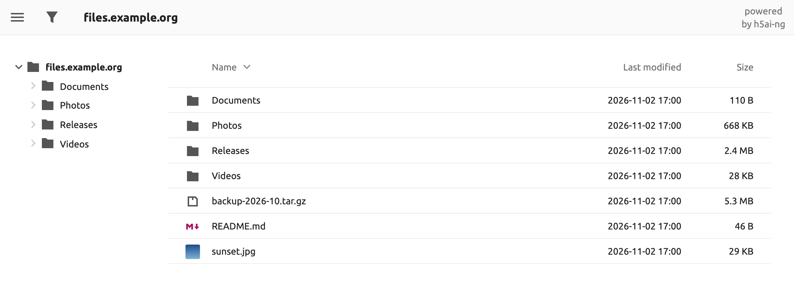

# h5ai-ng

[English](README.md) · [한국어](README.ko.md) · [Español](README.es.md) · [日本語](README.ja.md) · **简体中文**

[![license][license-img]][license] [![ci][ci-img]][ci] [![docker][docker-img]][docker-hub]

适用于 Apache httpd、lighttpd 和 nginx 的文件索引页面。访客可以浏览文件夹，预览图片、
视频、音频和文本，按名称筛选，并把选中的文件打包成一个压缩包下载。文件始终留在原处。

h5ai-ng 是 Lars Jung 所作 [h5ai][h5ai] 的维护分支。原项目自 2021 年起不再发布新版本。

## 为什么选择 h5ai-ng

* **只读，无需数据库。** 它只替换服务器自带的目录列表，从不写入你的文件。
* **支持新版 PHP。** 可在 PHP 8.3 及以上版本运行；Docker 镜像内置 PHP 8.5。
* **不请求第三方服务。** 字体随界面一起分发，打开页面时只访问你自己的服务器。
* **沿用原有 h5ai 配置。** `options.json`、URL 以及 `default` 和 `comity`
  图标主题都可以继续使用。

## 使用 Docker 快速开始

~~~sh
docker run -d --name h5ai -p 80:80 \
  -v /path/to/files:/h5ai \
  -v /path/to/config:/config \
  -e PUID=1000 -e PGID=1000 -e TZ=Asia/Shanghai \
  --restart unless-stopped \
  awesometic/h5ai-ng
~~~

打开 `http://localhost/` 即可。镜像发布了 `linux/amd64`、`linux/arm64`、
`linux/arm/v7` 和 `linux/arm/v6` 版本。

| 卷 | 内容 |
| --- | --- |
| `/h5ai` | 要提供的文件。可以按需以只读方式（`:ro`）挂载。 |
| `/config` | `h5ai/_h5ai`（程序及其 `options.json`）和 `nginx/h5ai.conf`。首次启动时创建。 |
| `/logs` | 可选。删除容器后仍会保留的 Nginx 和 PHP 日志。 |

| 变量 | 默认值 | 含义 |
| --- | --- | --- |
| `PUID`, `PGID` | `911` | `/config` 和服务器进程的所有者。 |
| `TZ` | `Asia/Seoul` | 日期显示和日志轮转使用的时区。 |
| `HTPASSWD` | `false` | 设为 `true` 后，所有访客都需要登录。 |
| `HTPASSWD_USER`, `HTPASSWD_PW` | `guest`、空 | 登录账号。未设置密码时，请先用 `-it` 启动一次并输入密码。 |
| `LOG_ROTATE_INTERVAL_DAYS`, `LOG_RETENTION_DAYS` | `1`、`30` | `/logs` 下文件的轮转间隔和保留天数。 |

镜像只提供未加密的 HTTP。请在前面放一个带 TLS 的反向代理，启用 `HTPASSWD` 时尤其如此。

## 安装到自己的服务器

1. 从 [Releases][releases] 下载 `h5ai-<version>.zip`，或自行构建（见下文）。
   **不要**直接复制 `src` 中的文件，必须先构建。
2. 解压到网站根目录，使 `_h5ai` 与你的文件位于同一层级。
3. 把 `/_h5ai/public/index.php` 添加为最后一个目录索引：
   * Apache httpd：`DirectoryIndex index.html index.php /_h5ai/public/index.php`
   * lighttpd：`index-file.names += ("/_h5ai/public/index.php")`
   * nginx：`index index.html index.php /_h5ai/public/index.php;`
4. 使用 nginx 时，请禁止访问 `/_h5ai/private/`；保护该目录的 `.htaccess`
   文件只在 Apache httpd 上生效：

   ~~~nginx
   location ^~ /_h5ai/private/ { deny all; }
   ~~~

需要 PHP 8.3 或更高版本。访客需要使用 Chrome 或 Edge 91、Firefox 90 或 Safari 15
及以上版本；更旧的浏览器会看到简单列表。

## 配置

配置位于 `_h5ai/private/conf/options.json`（Docker 中为
`/config/h5ai/_h5ai/private/conf/options.json`）。每个选项的说明都写在文件里。

打开 `/_h5ai/public/index.php` 会进入信息页，用于检查服务器支持哪些功能。该页面的
预设密码为空，请自行设置：把密码的 SHA-512 哈希填入 `passhash`。

~~~sh
printf '%s' '你的密码' | sha512sum    # macOS: shasum -a 512
~~~

## 从 docker-h5ai 迁移

[docker-h5ai][docker-h5ai] 用户可以保留原有的卷和变量，只需更换镜像名称。

1. 备份配置文件夹：
   `cp -a /path/to/config /path/to/config.bak`
2. 删除旧容器，用相同的 `-v` 和 `-e` 选项启动 `awesometic/h5ai-ng`：
   先执行 `docker rm -f h5ai`，再执行上面的 `docker run` 命令。
3. 查看 `docker logs h5ai`。首次启动时，容器会：
   * 用新版本替换 `/config/h5ai/_h5ai`，并把旧设置保存为
     `/config/<date>_options.json.bak`；
   * 在 `/config/nginx/h5ai.conf` 中屏蔽 `/_h5ai/private/`，并把旧文件保存为
     `/config/<date>_h5ai.conf.bak`。如果该文件改动过多而无法自动更新，
     容器会停止并提示需要修改的地方。
4. 恢复设置。新的 `options.json` 从默认值开始，信息页密码也为空。若要保持原样，
   用备份文件覆盖它并重启：

   ~~~sh
   cp /path/to/config/<date>_options.json.bak \
      /path/to/config/h5ai/_h5ai/private/conf/options.json
   docker restart h5ai
   ~~~

   如果你没有改过相关条目，旧文件会关闭筛选功能，并从 Google Fonts 加载字体；
   如需采用这些新默认值，请把两个文件对比后再合并。

如需回退，停止容器，恢复 `/path/to/config.bak`，然后重新启动 `awesometic/h5ai`。

## 构建

需要 [Node.js 24][node]。构建出的 `_h5ai` 文件夹位于 `build`。

~~~sh
npm ci
npm run build     # build/_h5ai
npm run release   # 同时生成 build/h5ai-<version>.zip（需要 zip）
docker build -t h5ai-ng .
~~~

问题报告和拉取请求请提交到[本仓库][issues]。原 h5ai 中尚未合并的拉取请求也会在这里
逐一审阅。

## 维护者的其他项目

[ToneDial][tonedial] 是一个为编程代理赋予性格的本地 CLI。从 7 个角色中选择一个，或调整
12 个语气维度，Claude Code、Codex 或 Antigravity 就会在你的各个项目中用这种语气回复。
目前仍在开发中，需要 Node 22 或更高版本。

~~~sh
npm install --global tonedial
~~~

## 许可证

MIT 许可证。以下为英文原文。

The MIT License (MIT)

Copyright (c) 2020 Lars Jung (https://larsjung.de)

Permission is hereby granted, free of charge, to any person obtaining a copy
of this software and associated documentation files (the "Software"), to deal
in the Software without restriction, including without limitation the rights
to use, copy, modify, merge, publish, distribute, sublicense, and/or sell
copies of the Software, and to permit persons to whom the Software is
furnished to do so, subject to the following conditions:

The above copyright notice and this permission notice shall be included in
all copies or substantial portions of the Software.

THE SOFTWARE IS PROVIDED "AS IS", WITHOUT WARRANTY OF ANY KIND, EXPRESS OR
IMPLIED, INCLUDING BUT NOT LIMITED TO THE WARRANTIES OF MERCHANTABILITY,
FITNESS FOR A PARTICULAR PURPOSE AND NONINFRINGEMENT. IN NO EVENT SHALL THE
AUTHORS OR COPYRIGHT HOLDERS BE LIABLE FOR ANY CLAIM, DAMAGES OR OTHER
LIABILITY, WHETHER IN AN ACTION OF CONTRACT, TORT OR OTHERWISE, ARISING FROM,
OUT OF OR IN CONNECTION WITH THE SOFTWARE OR THE USE OR OTHER DEALINGS IN
THE SOFTWARE.

## 致谢

**h5ai** 使用了其他项目的成果，这些项目同样采用 MIT 许可证。例外是部分
[Material Design 图标][material-design-icons]（CC BY 4.0）以及 Ubuntu 和 Ubuntu Mono 字体
（[`@fontsource/ubuntu`][fontsource-ubuntu] 和 [`@fontsource/ubuntu-mono`][fontsource-ubuntu-mono]
5.3.0，Ubuntu Font Licence 1.0）。字体未经修改，与其许可证一起放在 `_h5ai/public/fonts/` 中。

[h5ai]: https://larsjung.de/h5ai/
[tonedial]: https://github.com/awesometic/tonedial
[license]: #许可证
[ci]: https://github.com/awesometic/h5ai-ng/actions/workflows/ci.yml
[docker-hub]: https://hub.docker.com/r/awesometic/h5ai-ng
[releases]: https://github.com/awesometic/h5ai-ng/releases
[issues]: https://github.com/awesometic/h5ai-ng/issues
[docker-h5ai]: https://github.com/awesometic/docker-h5ai
[node]: https://nodejs.org
[material-design-icons]: https://github.com/google/material-design-icons
[fontsource-ubuntu]: https://www.npmjs.com/package/@fontsource/ubuntu
[fontsource-ubuntu-mono]: https://www.npmjs.com/package/@fontsource/ubuntu-mono

[license-img]: https://img.shields.io/badge/license-MIT-a0a060.svg?style=flat-square
[ci-img]: https://img.shields.io/github/actions/workflow/status/awesometic/h5ai-ng/ci.yml?branch=main&style=flat-square
[docker-img]: https://img.shields.io/docker/pulls/awesometic/h5ai-ng?style=flat-square
